<div align="center">


# Swift Download Manager

**Free, open-source download manager and download accelerator for Windows, Linux and macOS.**

Split every file into up to 32 connections, pause and resume (even after a restart), queue and schedule downloads, and send downloads from Chrome, Edge, Firefox, Brave and Opera straight to the app. A modern, fast alternative to Internet Download Manager (IDM), written in Rust.

[](https://github.com/Namitjain07/Swift-Download-Manager/releases/latest)
[](LICENSE)


[**Download the latest release**](https://github.com/Namitjain07/Swift-Download-Manager/releases/latest) · [Features](#features) · [Screenshots](#screenshots) · [Browser add-on](#browser-add-on) · [Web interface and Docker](#run-it-for-your-organisation) · [FAQ](#frequently-asked-questions)

<picture>
  <source media="(prefers-color-scheme: dark)" srcset="docs/images/screenshot-dark.png">
  
</picture>

<sub>The main window, light and dark (it follows your system), with the app's built-in sample data (<code>--demo</code> mode).</sub>

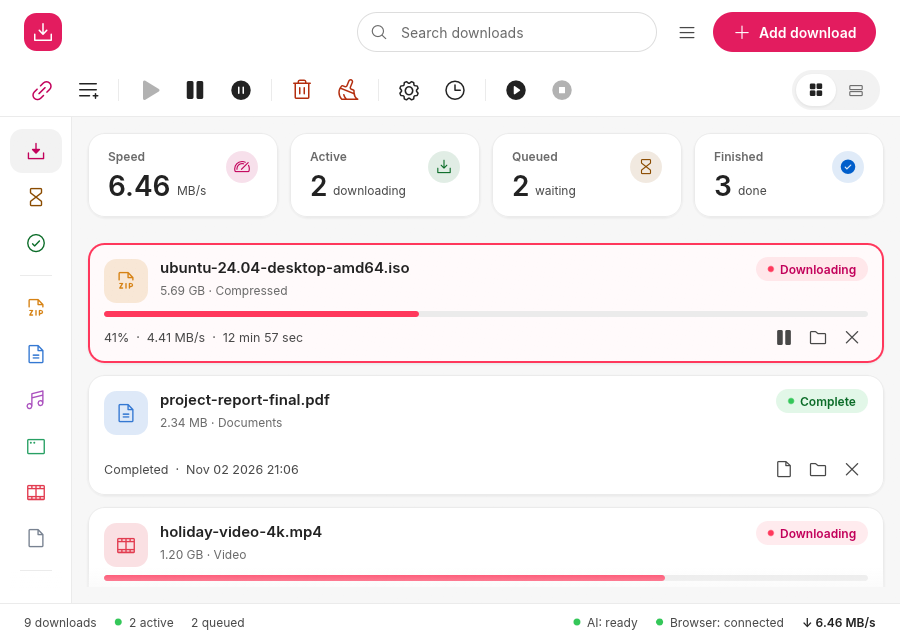 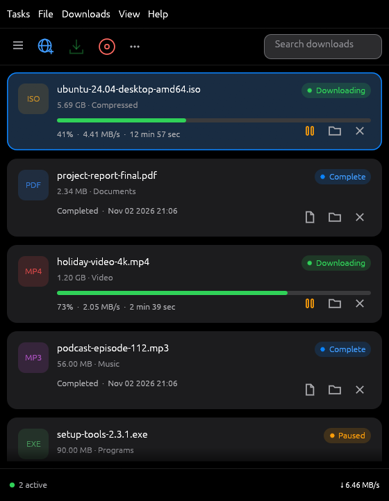 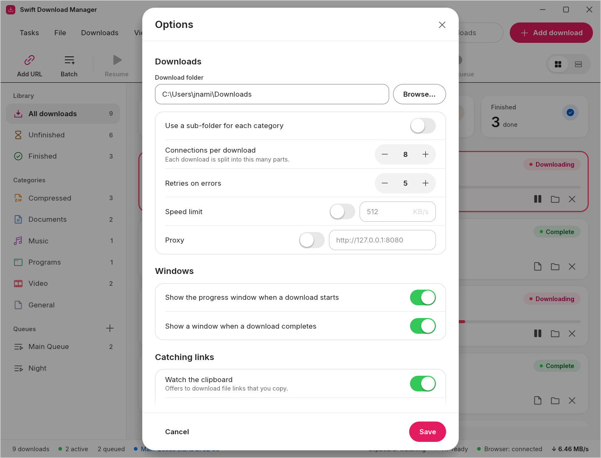

<sub>It adapts to the window: full layout, an icon rail at medium widths, a drawer and one menu button when narrow. Right: the Options window.</sub>

</div>

## Why Swift Download Manager?

Browsers download each file over a single connection, so a fast line often sits mostly idle, and a dropped connection can mean starting over. Swift Download Manager is a free **download accelerator**: it splits every file into several parts, downloads them at the same time, re-splits as parts finish, and keeps going when a connection drops. Big files finish sooner, and a broken connection never means starting over.

- **Free and open source** (Apache License 2.0). No ads, no account, and no telemetry or update pings: the program only talks to the servers you download from.
- **Cross-platform**: one program for Windows 10/11, Ubuntu, Debian and Linux Mint, and macOS (built on a Mac).
- **Fast and light**: written in Rust. On Windows it is one self-contained `.exe` that needs no installer.
- **Built for everyday use**: pause and resume, queues with schedules, categories, batch downloads, a link grabber, clipboard watching, speed limits and a proxy.
- **Works with your browser**: an add-on for Chrome, Edge, Brave, Opera and Firefox catches downloads and passes your login along.
- **More than a desktop app**: a web interface, a multi-user server with a Docker image, and a built-in MCP server so AI assistants such as Claude can manage downloads.

## Features

**Fast and reliable**
- Splits each download into up to **32 connections**; a free connection takes half of the biggest remaining part
- **Pause and resume**, even after closing the app; broken connections are retried and busy servers get fewer connections
- **SHA-256 checksum** check, plus refreshing a link that has expired

**A calm, native-feeling window**
- **Responsive**: downloads are cards in a grid that gains columns as the window widens (or the classic table, one click away); the sidebar becomes an icon rail and then a drawer, and the toolbar collapses to icons and an overflow menu on narrow windows
- **In a web browser and for a whole team**: a page on a localhost address, and a Docker image that serves several people from one machine
- **Several networks at once**: tick Wi-Fi, Ethernet, a phone's hotspot and more under **Options → Networks** and every download uses all of them together, so the speeds add up
- One consistent design, inspired by Airbnb and drawn with iOS-style controls: white surfaces on a soft grey page, one coral accent, 16 px rounded cards with soft shadows, capsule buttons, an iOS switch, stepper and segmented control, and line icons from [Phosphor](https://phosphoricons.com). Text is set in [Inter](https://rsms.me/inter/). Flat colours only, no gradients. Light and dark, following your system (or choose under **View → Appearance**)
- **14 colour themes** to choose from in **Options → Appearance**: Coral (the default), **Files** (a Windows 11 look with small corners and a blue accent), **Carbon** (sharp corners), Blue, Green, Black, Purple, Pink, Orange, Teal, Gold, Nord, Dracula and Mocha, each in light and dark. Automated tests check that text stays easy to read in every theme, and switching glides from one look to the next
- **A title bar in the theme's colours**: the app draws its own minimise, maximise and close buttons instead of the system's grey bar, so the whole window matches. Drag it to move the window, double-click to maximise, resize from any edge (macOS keeps its traffic lights; `--native-title-bar` brings the system's bar back)
- **See a download at work**: the parts of a file are drawn as channels that flow along smooth curves into one file, each at its own speed, and the file fills up as data arrives. Waiting is shown with a smooth loader or a sliding bar, never a frozen window
- Smooth animations: buttons fade and press, the sidebar highlight slides, progress bars and the speed number glide, and dialogs fade and rise into place. The window stays idle when nothing moves

**Runs in the background**
- Close the window and **keep downloading**: an icon in the system tray (Windows notification area, macOS menu bar, Linux tray) shows what is going on, pauses and resumes everything, and opens the window again
- Queues, schedules and the browser add-on keep working with no window open; optionally **start with the system**, in the background

**Organised**
- **Queues** with their own schedules (start and stop times, daily or once, close the app when done)
- **Categories** with your own file types and folders, search, and sorting by any column
- **Batch downloads**: a list of links, or numbered links such as `img*.jpg`; import and export link lists, or drop link files onto the window
- **Link grabber** that lists the files a web page links to

**In control**
- Overall and per-download **speed limits**, a **proxy**, saved site logins, and a referrer and login per download
- **Clipboard watching**: copy a download link and the app offers to download it
- A download-complete window when a file is finished

**AI assistants** (Model Context Protocol)
- Let Claude or another MCP-capable assistant list, add, pause, resume and remove downloads: see [Use it from an AI assistant](#use-it-from-an-ai-assistant-mcp)
- Works with the window open, or without it: close the window and the assistant's downloads keep going; open it again and it takes over mid-download
- On by default with a switch in the app; assistants cannot delete files or choose folders

**Browser add-on** (Chrome, Edge, Brave, Opera and Firefox)
- Catches downloads you start in the browser and hands them to the app
- Passes your browser login (cookies) along, so downloads behind a login work
- Adds **Download with Swift Download Manager** to the right-click menu
- Spots videos and sounds that a page plays, and offers them in a pop-up that has the look of the app (light and dark)

What is finished and what is still planned (integrations with package managers, other tools and more) is in the [roadmap](#roadmap-and-feature-checklist).

## Screenshots

<table>
<tr>
<td width="50%">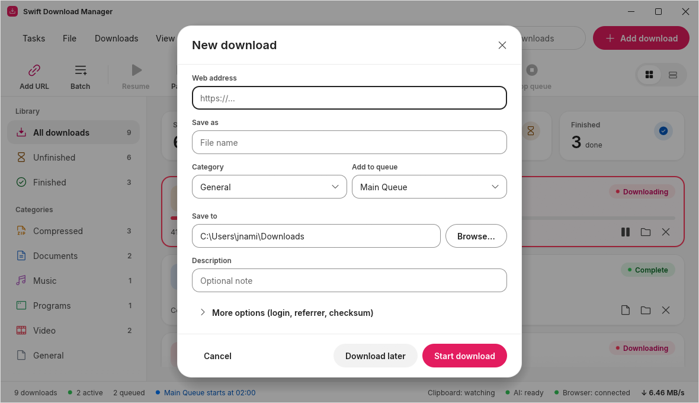<br><sub><b>Add a download</b>: paste a link, pick a category, a queue and a folder. Light mode.</sub></td>
<td width="50%">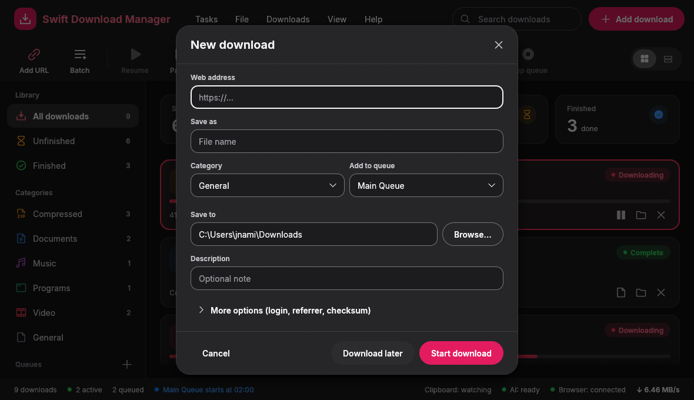<br><sub><b>Dark mode</b> follows your system, or you can choose it yourself.</sub></td>
</tr>
<tr>
<td>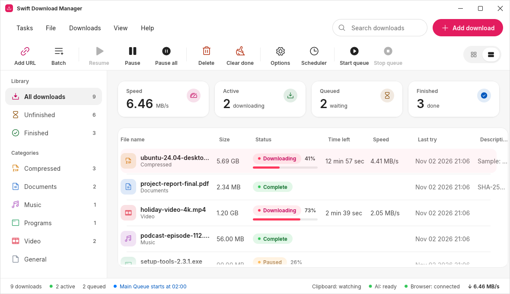<br><sub><b>Table view</b>: sortable columns for people who like a classic download list.</sub></td>
<td>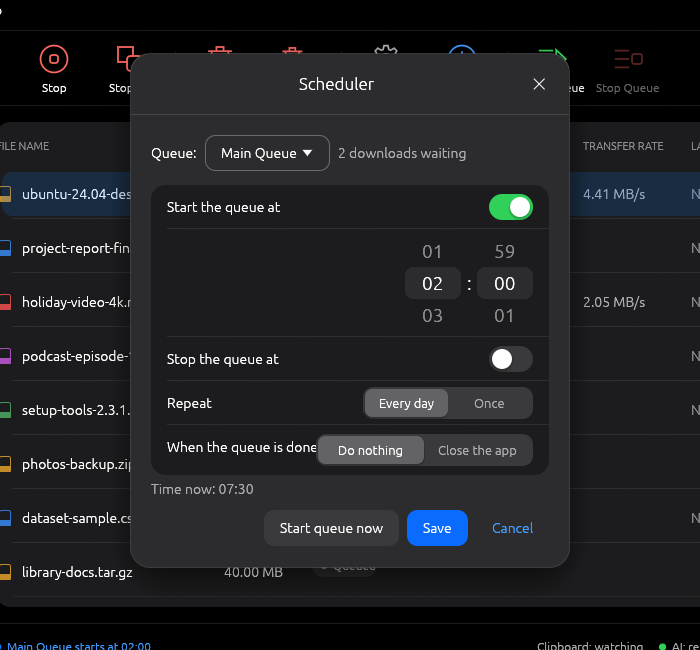<br><sub><b>Download scheduler</b>: start and stop a queue at set times, daily or once.</sub></td>
</tr>
<tr>
<td>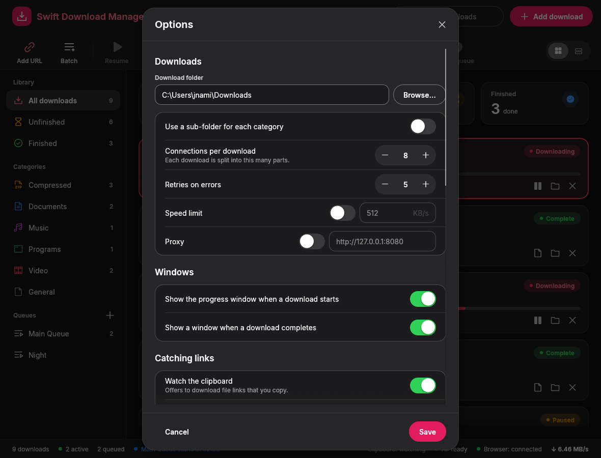<br><sub><b>Options</b>: up to 32 connections per download, retries, speed limit and proxy.</sub></td>
<td>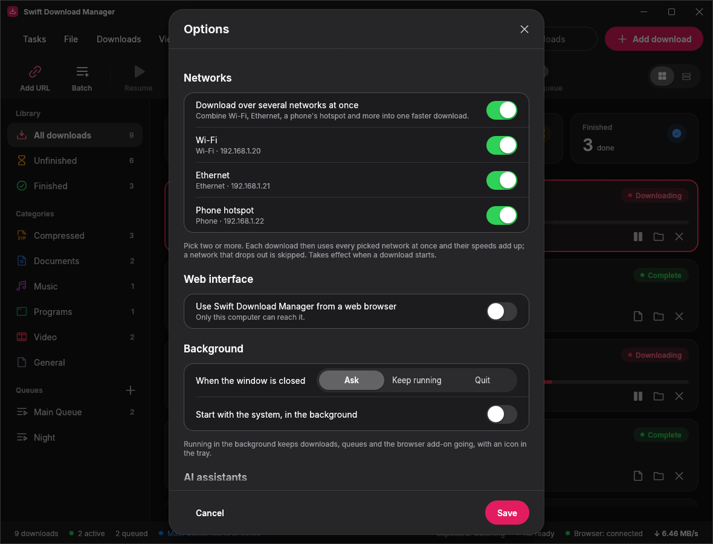<br><sub><b>Several networks at once</b>: use Wi-Fi, Ethernet and a phone hotspot together.</sub></td>
</tr>
<tr>
<td>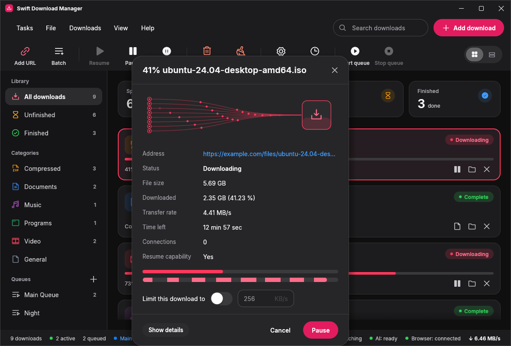<br><sub><b>See it at work</b>: each part of the file is a channel that flows into the finished file at its own speed.</sub></td>
<td>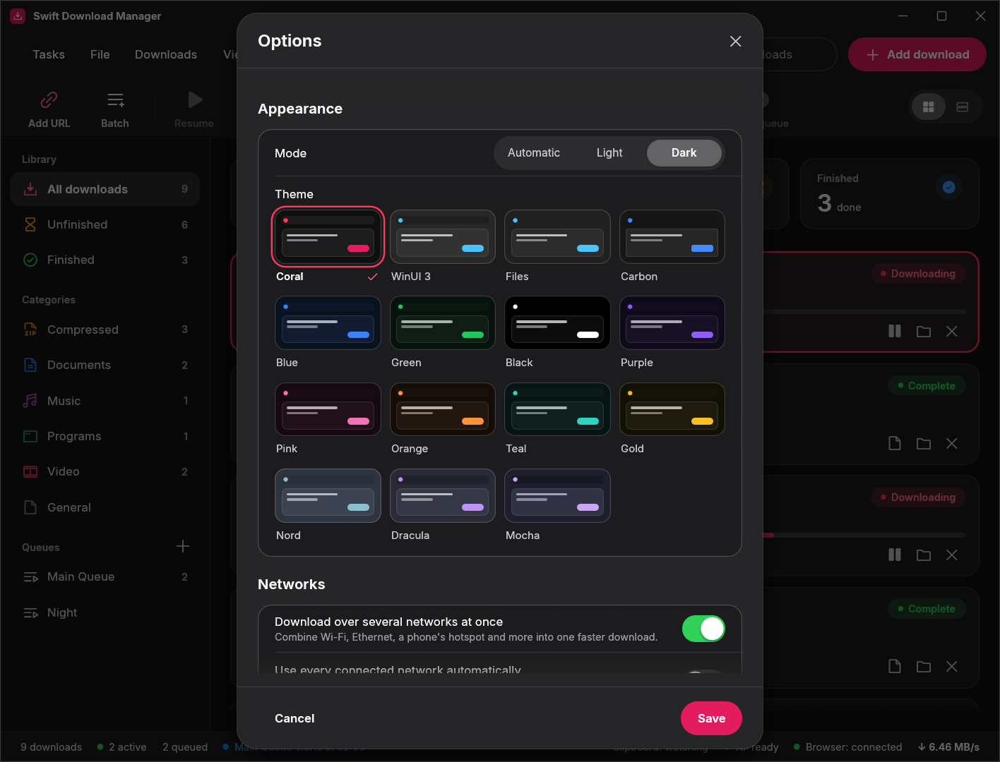<br><sub><b>14 themes</b>: pick one by its picture under Options → Appearance.</sub></td>
</tr>
<tr>
<td>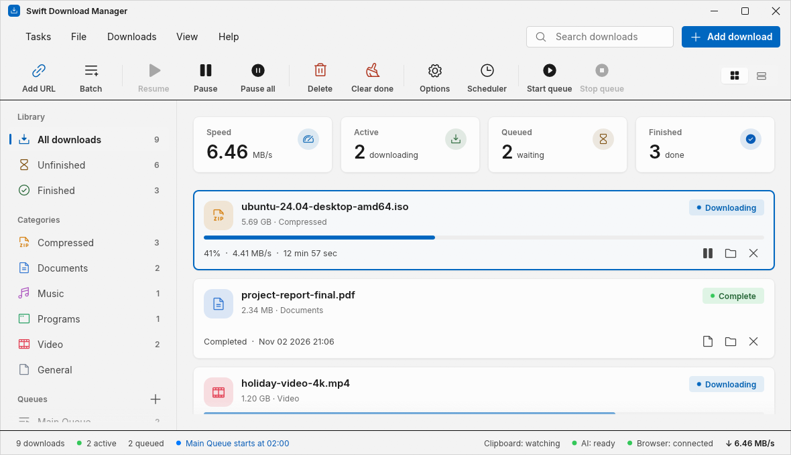<br><sub><b>Files</b>: small corners and a blue accent, inspired by the Files app for Windows 11.</sub></td>
<td>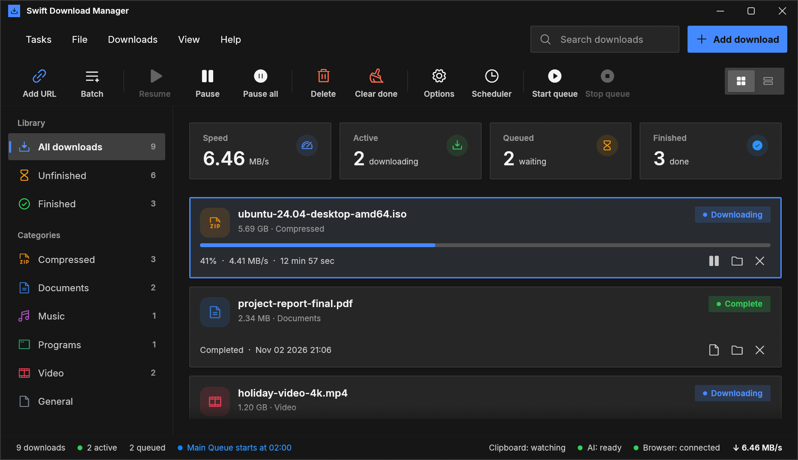<br><sub><b>Carbon</b>: square corners and a dark, technical look.</sub></td>
</tr>
</table>

### Colour themes

Fourteen themes, each in light and dark. Click a picture to see it full size.

<a href="docs/images/themes-dark.png">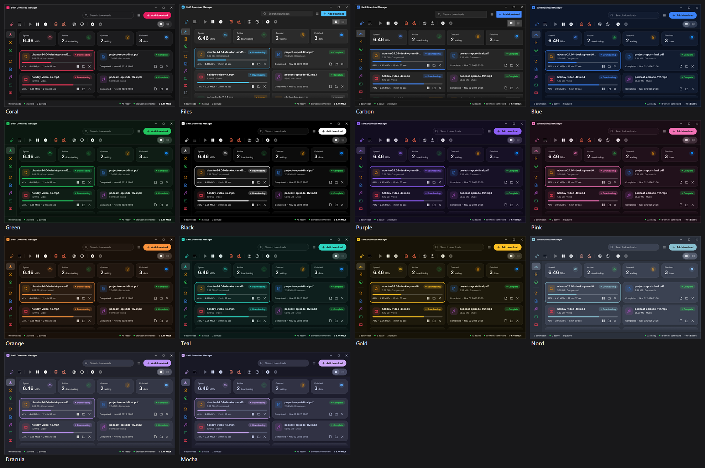</a>

<a href="docs/images/themes-light.png">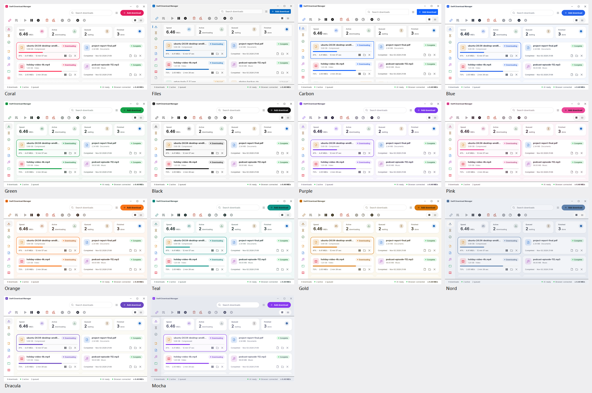</a>

Choose one under **Options → Appearance** or **View → Appearance → Theme**. To try one for a single run, start the program with
`--color-theme files` (or `carbon`, `blue`, `green`, `black`, `purple`, `pink`, `orange`, `teal`, `gold`, `nord`, `dracula`, `mocha`, `coral`).

## Frequently asked questions

**Is Swift Download Manager free?**
Yes. It is free and open source under the Apache License 2.0, with no ads, no account and no paid tier.

**How is it different from Internet Download Manager (IDM)?**
IDM is Windows-only, closed source and paid. Swift Download Manager follows the same proven idea (segmented downloading, queues, a scheduler and browser integration) but is free and open source, runs on Windows, Linux and macOS, and adds a web interface, a multi-user Docker server, downloading over several networks at once and control by AI assistants.

**How does it make downloads faster?**
Many servers limit the speed of each connection. Swift Download Manager opens several connections to the same file (up to 32), each fetching a different part, so the speeds add up. When a part finishes, the biggest remaining part is split so that no connection sits idle. How much faster it gets depends on the server: some allow only one connection per file, and then the download simply runs on one.

**Can I pause and resume a download?**
Yes, also after closing the app or restarting the computer, as long as the server supports resuming. Broken connections are retried automatically, and a link that has expired can be refreshed so the download carries on where it stopped.

**Does it work with Chrome, Edge, Firefox and Brave?**
Yes, with the browser add-on for Chrome, Edge, Brave, Opera and Firefox. It catches downloads you start in the browser, passes your browser login (cookies) along and adds *Download with Swift Download Manager* to the right-click menu. See [Browser add-on](#browser-add-on).

**Can I download over Wi-Fi and Ethernet at the same time?**
Yes. Under **Options → Networks** you can tick several network cards (Wi-Fi, Ethernet, a phone's hotspot) and every download uses all of them together. See [Download over several networks at once](#download-over-several-networks-at-once).

**Can I run it on a server, a NAS or in Docker?**
Yes. `swift_download_manager --server` runs without a window and serves a web page where several people sign in with their own accounts, and there is a Docker image on GitHub Container Registry. See [Run it for your organisation](#run-it-for-your-organisation).

**Is it safe? Windows says the publisher is unknown.**
Every release is built by GitHub from the source code in this repository, and the Windows program is signed with the project's own certificate (its fingerprint is in [SECURITY.md](SECURITY.md)). Because that certificate is not issued by a commercial authority, Windows may show *unknown publisher*: choose **More info**, then **Run anyway**. Each release lists a `SHA256SUMS` file so you can check what you downloaded. See [Windows warnings and antivirus](#windows-warnings-and-antivirus).

**Does it collect any data?**
No. There is no telemetry, no analytics and no update check in the program. It only contacts the servers you download from.

**Can an AI assistant use it?**
Yes. Claude and other assistants that speak the Model Context Protocol (MCP) can list, add, pause, resume and remove downloads, but never delete files or choose folders. See [Use it from an AI assistant](#use-it-from-an-ai-assistant-mcp).

**Can I change how it looks?**
Yes. Under **Options → Appearance** you choose light, dark or automatic, and one of 14 colour themes (Coral, Files, Carbon, Blue, Green, Black, Purple, Pink, Orange, Teal, Gold, Nord, Dracula and Mocha). The choice is saved and applies at once, with a short glide from the old look to the new one. See [Colour themes](#colour-themes).

**Why does the window have its own title bar? Can I get the system's back?**
The app draws its own minimise, maximise and close buttons so that the title bar has the colours and corners of the theme you picked. Dragging, double-click to maximise and resizing from the edges work as usual. If you prefer the system's bar (or your desktop handles frameless windows badly), start the program with `--native-title-bar`.

**Where do I report a bug or ask for a feature?**
Open an [issue](https://github.com/Namitjain07/Swift-Download-Manager/issues/new/choose). Pull requests are welcome; see the [contributing guide](CONTRIBUTING.md).

## Run it in the background

By default, closing the window while downloads are running asks whether to **keep downloading in the background**; you can remember the answer
(**Options → Background**) or use **Tasks → Keep running in the background** at any time. The program then carries on without a window, with an icon in the
system tray:

- **Click the icon** (or choose *Open Swift Download Manager*) to bring the window back; it takes the downloads over without interrupting them
- *Pause all downloads* and *Resume downloads* from the icon's menu; the tooltip shows how many downloads run and how fast
- *Quit* stops everything and exits. **Tasks → Exit** in the window always quits
- Links from the browser add-on are added and started straight away while there is no window
- **Options → Background → Start with the system** starts it at login, in the background (a launch entry on Linux and macOS, a `Run` key on Windows)

On Linux the icon needs a desktop that shows tray icons (KDE, Xfce, Cinnamon, MATE, or GNOME with the AppIndicator extension). Without one, the program still
runs in the background; start it again to open the window.

## Use it from a web browser

Open **Options → Web interface**, turn it on and press **Open**. The page lists your downloads as cards, and lets you add links, pause, resume,
remove and download finished files. It follows your system's light or dark setting and works on a phone as well.

<p align="center">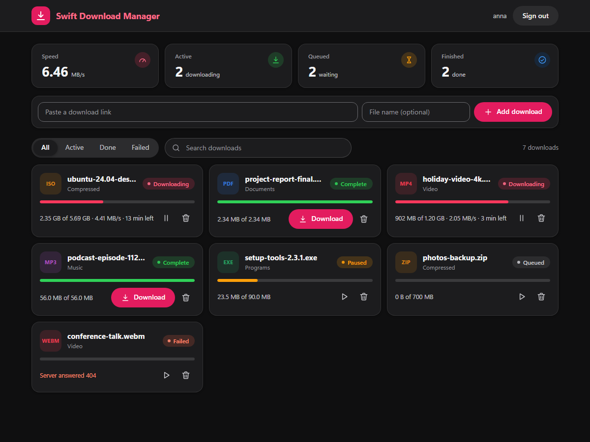</p>

- Only this computer can reach it (`127.0.0.1`, port 9615 unless you change it). The link carries a secret key, so treat it like a password; the browser
  swaps it for a cookie and the key disappears from the address bar
- It runs inside the window, or in the background when only the tray icon is left

## Run it for your organisation

`swift_download_manager --server` runs as a download server with no window. People sign in to the web page with their own accounts, add links, and the **server**
downloads them; they fetch the finished files through the same address. Each person sees only their own downloads and gets a folder of their own
(`/data/downloads/<name>`); administrators see everybody's.

<p align="center">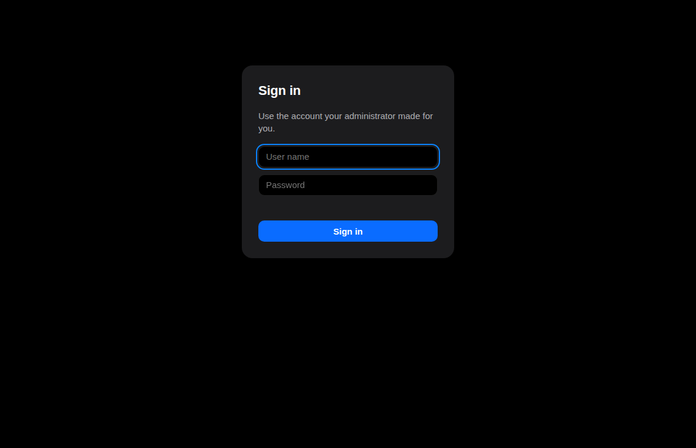 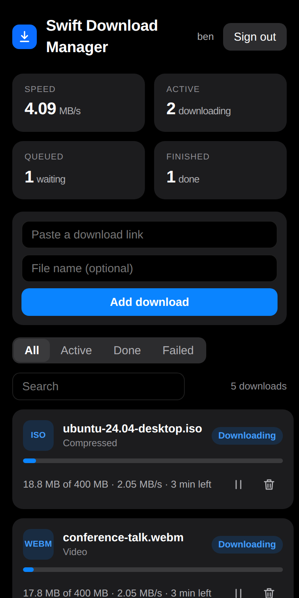</p>

### With Docker

```sh
docker run -d --name sdm -p 8080:8080 -v sdm-data:/data \
  -e SDM_ADMIN_USER=admin -e SDM_ADMIN_PASSWORD='a long password' \
  ghcr.io/namitjain07/swift-download-manager:latest
```

Open <http://localhost:8080/> and sign in. (`:latest` follows the newest stable release and `:1.7.0` pins this one; pre-releases get the `:beta` tag instead.)
Everything lives in the `/data` volume: settings, accounts, the download list and the files. The image is for 64-bit Intel/AMD machines for now.

Add more people:

```sh
docker exec -i -e SDM_PASSWORD='their password' sdm swift-download-manager --add-user anna          # a normal user
docker exec -i -e SDM_PASSWORD='their password' sdm swift-download-manager --add-user ben --admin   # an administrator
docker exec sdm swift-download-manager --list-users
docker exec sdm swift-download-manager --remove-user anna      # their downloads stay on disk
```

With docker compose:

```yaml
services:
  sdm:
    image: ghcr.io/namitjain07/swift-download-manager:latest
    restart: unless-stopped
    ports: ["8080:8080"]
    volumes: ["sdm-data:/data"]
    environment:
      SDM_ADMIN_USER: admin
      SDM_ADMIN_PASSWORD: change-me-to-a-long-password
volumes:
  sdm-data:
```

### Without Docker

```sh
SDM_PASSWORD='a long password' swift_download_manager --server --add-user admin --admin --data /srv/sdm
swift_download_manager --server --data /srv/sdm --downloads /srv/sdm/files --bind 0.0.0.0 --port 8080
```

Options (each also has an environment variable): `--bind` (`SDM_BIND`, default `0.0.0.0`), `--port` (`SDM_PORT`, `8080`), `--data` (`SDM_DATA`), `--downloads`
(`SDM_DOWNLOADS`), `--secure-cookie` (`SDM_SECURE_COOKIE`), `--allow-private` (`SDM_ALLOW_PRIVATE`).

### Before you put it on a network

- **Use HTTPS.** The server speaks plain HTTP; put a reverse proxy in front of it (Caddy, nginx, Traefik) that adds TLS, and add `--secure-cookie`. For example, with Caddy:
  `sdm.example.org { reverse_proxy localhost:8080 }`
- **Private addresses are refused.** A download server can be tricked into fetching from the network behind it, so links to private or local addresses
  (`10.x`, `192.168.x`, `localhost`, the cloud metadata address, ...) are refused, also after redirects. `--allow-private` switches that off for a trusted team
- Passwords are stored as salted hashes; five wrong passwords from one address block it for five minutes; sessions last a week and end when you sign out
- Accounts are managed from the command line; there is no page for it yet. It is a pre-release: please report what you find

## Download over several networks at once

Open **Options → Networks**, turn on **Download over several networks at once** and tick the network cards to use: Wi-Fi, Ethernet, a phone's
USB or hotspot connection. A download is then spread over all of them.

<p align="center"></p>

- Each connection of a download is tied to one network card. Every card always gets a connection and the faster cards get more, so the speeds add
  up and a slow card never holds the others back
- A card that stops working (cable pulled, phone out of range) is left alone for 30 seconds while the others carry on
- The progress window shows what each network is carrying
- When networks are chosen, nothing falls back to the normal connection: if none of them works, the download says so
- Linux ties the traffic to the card with `SO_BINDTODEVICE` (kernel 5.7 or newer; older kernels use the card's address), macOS with `IP_BOUND_IF`, and
  Windows with the card's address. The logic is tested on Linux with separate local addresses standing in for networks; it has not yet been tried with
  real phones and cables on Windows or macOS, so please report what you see

## Use it from an AI assistant (MCP)

Swift Download Manager speaks the [Model Context Protocol](https://modelcontextprotocol.io), so an assistant such as Claude
can look at your downloads and manage them for you ("download this video", "pause everything", "what is still running?").

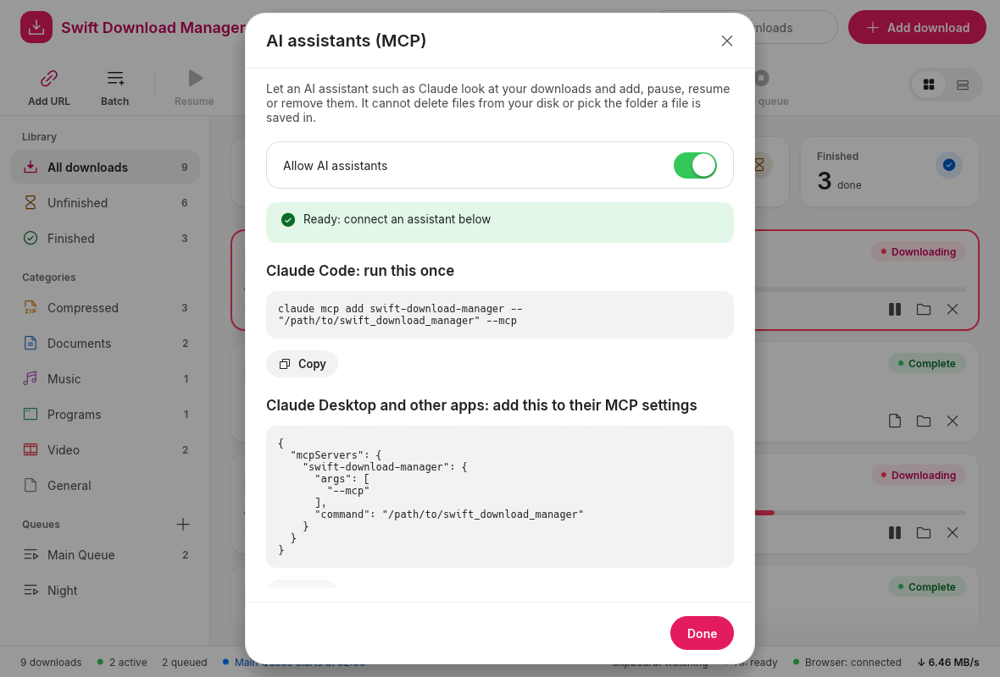

**Connect it.** The assistant starts the program itself with `--mcp`. The app shows these commands with the right path
filled in under **Help → AI assistants…**.

| Client | How |
| --- | --- |
| Claude Code | `claude mcp add swift-download-manager -- /path/to/swift_download_manager --mcp` |
| Claude Desktop and most other apps | add the block below to their MCP settings |

```json
{ "mcpServers": { "swift-download-manager": { "command": "/path/to/swift_download_manager", "args": ["--mcp"] } } }
```

On Windows use the path of `SwiftDownloadManager.exe`. (`--mcp` talks over standard input and output, which relies on the
assistant starting the program with pipes, as MCP clients do.)

**What it can do.** Ten tools; assistants that support it ask you before each action unless you tell them not to.

| Tool | What it does |
| --- | --- |
| `list_downloads`, `get_download` | See downloads, their progress, speed and errors (read-only) |
| `get_status`, `list_queues` | Overall state; queues and their schedules (read-only) |
| `add_download` | Start a download from an `http(s)` link; saved in the folder of its category |
| `pause_download`, `resume_download` | Pause or resume one download |
| `start_queue`, `stop_queue` | Run or stop a queue |
| `remove_download` | Take a download off the list (marked as destructive so clients ask first) |

**With or without the window.** If the window is open, the assistant works in it and you see changes live. If it is
closed, the assistant runs the downloads itself in the background. Opening the window while a download is running pauses it,
hands everything over and carries on in the window, byte for byte. (If the window is minimized and your system stops
redrawing it, a request can time out after 10 seconds with a message saying so; restore the window and ask again.)

**Safety.**
- It is on by default; switch it off under **Options** or **Help → AI assistants…** and every request is refused.
- An assistant can never delete files from your disk (not even partly downloaded ones) and cannot choose where a file is
  saved: the folder always comes from the file's category. Only `http` and `https` links are accepted.
- The window listens only on your own computer, on a random port, and only answers requests that carry a secret token stored in
  your settings folder (`mcp-token`, readable only by you). Requests that come from a web page are refused. This is separate
  from the browser add-on's listener.
- Passwords and cookies are never shown to the assistant.

## Download

Get the files from the [**latest release**](https://github.com/Namitjain07/Swift-Download-Manager/releases/latest).

| Platform | File | How to install |
| --- | --- | --- |
| **Windows 10/11** (64-bit) | `SwiftDownloadManager.exe` | Double-click it. No installer needed. It is signed with the project's own certificate, so Windows may say the publisher is unknown: choose **More info**, then **Run anyway** (see [Windows warnings](#windows-warnings-and-antivirus)). |
| **Windows**, with browser add-on | `SwiftDownloadManager-<version>-windows-x64.zip` | The same program together with the browser add-on, the certificate and a short read-me. |
| **Ubuntu 22.04+, Debian 12+, Mint 21+** (64-bit) | `swift-download-manager_<version>_amd64.deb` | Double-click it, or run `sudo apt install ./swift-download-manager_<version>_amd64.deb`. |
| **macOS** | build it, see below | A Mac app can only be built on a Mac. See [`mac/HOW TO GET THE MAC VERSION.txt`](mac/HOW%20TO%20GET%20THE%20MAC%20VERSION.txt). On first start, right-click the app and choose **Open**, because it is not signed with a paid Apple developer account. |
| **Other Linux** | build it, see below | `bash packaging/linux/build-deb.sh` in [`source/`](source/). |

All files are built and, for Windows, signed by GitHub from the release's source code (see [`release.yml`](.github/workflows/release.yml)).

Every release also lists a `SHA256SUMS` file so you can check what you downloaded.

### Browser add-on

| Browser | File |
| --- | --- |
| Chrome, Edge, Brave, Opera | `SwiftDownloadManager-Helper-<version>-chrome.zip` |
| Firefox | `SwiftDownloadManager-Helper-<version>-firefox.xpi` |

The app has to be running for downloads to go to it; otherwise the browser downloads as usual.

<p align="center">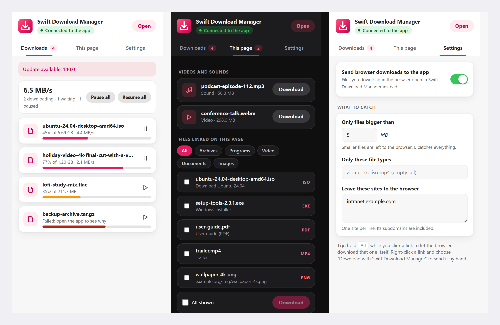</p>

<p align="center"><sub>The add-on's pop-up has the look of the app and follows the browser's light or dark setting.</sub></p>

- **Chrome, Edge, Brave, Opera:** unzip the file into a folder you keep, open `chrome://extensions` (Edge: `edge://extensions`),
  turn on **Developer mode**, click **Load unpacked** and choose the folder.
- **Firefox:** to try it now, open `about:debugging`, click **This Firefox**, then **Load Temporary Add-on…** and choose the `.xpi`.
  Temporary add-ons are removed when Firefox closes. To keep it, Firefox needs the file signed; see
  [`browser-extension/HOW TO INSTALL.txt`](browser-extension/HOW%20TO%20INSTALL.txt).

The same steps are in the app under **Help > Browser integration**.

### Windows warnings and antivirus

**"Windows protected your PC" / unknown publisher.** The exe is signed with this project's own code-signing certificate,
not one bought from a certificate authority, so Windows cannot tell who you are dealing with. That is expected. To check you have
the genuine file, compare its SHA-256 with `SHA256SUMS` on the release page and look at the signature:

```powershell
Get-AuthenticodeSignature .\SwiftDownloadManager.exe | Format-List Status, SignerCertificate
```

The signer must be `CN=Swift Download Manager, O=Namitjain07` with SHA-256 fingerprint
`22:B1:AE:1A:D3:BC:C4:0D:F5:3E:81:FD:D1:6A:E1:8E:83:22:2A:FC:51:B9:E6:A1:6A:F5:66:34:AE:F3:86:7A`
(the public certificate is `swift-download-manager-codesign.cer` in the zip and in the repository).

**`Trojan:Win32/Bearfoos.A!ml` or similar.** Version 1.2.0 was reported as this by Windows Defender. It is a *machine-learning guess* about
programs it has not seen before, not a match with known malware, and it was a false positive: that build was an unsigned program with no
icon, version information or manifest. From 1.3.0 the program is built with Microsoft's own toolchain, carries that information and is
signed. If Defender still objects, open **Protection history**, restore the file, and please
[send it to Microsoft](https://www.microsoft.com/en-us/wdsi/filesubmission) as a false positive (choose "Software developer").
The source is here to read; see also [`SECURITY.md`](SECURITY.md).

## Build it yourself

Install Rust from <https://rustup.rs>, then, in the [`source/`](source/) folder:

| For | Command | Result |
| --- | --- | --- |
| Run it now | `cargo run --release` | opens the app |
| Linux installer (.deb) | `bash packaging/linux/build-deb.sh` | `dist/*.deb` |
| Windows (from Windows) | `cargo build --release` | `target/release/swift_download_manager.exe` (with icon and version information) |
| Windows (from Linux, unsigned) | `bash packaging/windows/build-windows.sh` | `dist/windows/*.zip` (for testing; releases come from GitHub's Windows build) |
| Mac (on a Mac) | `bash packaging/macos/build-mac.sh` | `dist/*.dmg` |
| Browser add-on | `python3 packaging/browser/build_extension.py` | `dist/browser/` (Chrome .zip, Firefox .xpi) |
| Run the tests | `cargo test` | the automatic tests |

On Linux the app also needs the usual desktop libraries (they are already there on desktop systems).
The full build notes are in [`source/README.md`](source/README.md).

### Retaking the screenshots

The app can draw itself with sample data and save a picture of its window, which is how the screenshots above were made:

```bash
cd source
cargo run --release -- --screenshot ../docs/images/screenshot.png --theme light
cargo run --release -- --screenshot ../docs/images/screenshot-dark.png --theme dark
# a window other than the main one: --show add|batch|options|networks|appearance|scheduler|queues|properties|progress|delete|about|browser|ai|grabber|close|table|drawer|menus|empty
# a colour theme: --color-theme files|carbon|blue|green|black|purple|pink|orange|teal|gold|nord|dracula|mocha|coral
# a narrower window: --size 900x640   (or 600x760)
cargo run --release -- --screenshot /tmp/scheduler.png --theme dark --show scheduler
```

On a machine without a screen, put `xvfb-run -a` in front of the program.

## What is in this repository

| Path | What it is |
| --- | --- |
| [`source/`](source/) | The Rust source code and the installer scripts |
| [`source/src/engine.rs`](source/src/engine.rs) | The download engine: connections, splitting, resume, retries, speed limits |
| [`source/src/bridge.rs`](source/src/bridge.rs) | The local link listener for the browser add-on, and clipboard watching |
| [`source/src/background.rs`](source/src/background.rs), [`source/src/background/`](source/src/background/) | Running without a window: the tray icon and the loop behind it |
| [`source/src/mcp/`](source/src/mcp/) | The MCP server for AI assistants: protocol, the private control door, the lock and hand-over |
| [`source/src/app.rs`](source/src/app.rs), [`source/src/app/`](source/src/app/) | The window, dialogs, queues, scheduler and link grabber |
| [`source/src/theme/`](source/src/theme/), [`source/src/widgets/`](source/src/widgets/), [`source/src/icons.rs`](source/src/icons.rs) | The design (colours, sizes, fonts) in light and dark, the widget kit (buttons, inputs, menus, dialogs, switch, wheel picker, progress bars) and the icon set |
| [`browser-extension/`](browser-extension/) | The browser add-on, packaged for Chrome and Firefox |
| `mac/` | How to get the Mac version |
| [`docs/`](docs/) | Images used by this read-me |

Settings and the download list are saved in `~/.config/swift-download-manager/` on Linux and macOS,
and in `%APPDATA%\swift-download-manager\` on Windows.

## Releases

Releases are listed on the [releases page](https://github.com/Namitjain07/Swift-Download-Manager/releases), and what changed
in each one is in [`CHANGELOG.md`](CHANGELOG.md). Pushing a tag such as `v1.3.0` builds, signs and publishes a release (a version with a dash, such as `1.5.0-beta.1`, is published as a pre-release); see
[`.github/workflows/release.yml`](.github/workflows/release.yml).

## Roadmap and feature checklist

A ticked box (`[x]`) is built and in the program; an empty box (`[ ]`) is planned or still an idea. Items marked *(pre-release)* are in a pre-release
build and not yet in the stable version. The unticked items are ideas in a rough order, not promises: the list changes as people tell us what they need.
Want one of them? [Open an issue](https://github.com/Namitjain07/Swift-Download-Manager/issues/new/choose) first, so we can agree on the shape (see
[Contributing](#contributing)).

### Done

**Downloading**
- [x] Up to 32 connections per download; a free connection takes half of the biggest remaining part
- [x] Pause and resume, also after closing the app; retries, and fewer connections on busy servers
- [x] SHA-256 checksum check, and refreshing a link that has expired
- [x] Overall and per-download speed limits
- [x] Proxy, saved site logins, and a referrer and login per download
- [x] Download over several networks at once (Wi-Fi, Ethernet, a phone's hotspot)

**Organising**
- [x] Queues with schedules (start and stop times, daily or once, close the app when done)
- [x] Categories with your own file types and folders; search; sorting by any column
- [x] Batch downloads: a list of links, or numbered links such as `img*.jpg`
- [x] Import and export of link lists; drop link files onto the window
- [x] Link grabber that lists the files a web page links to
- [x] Clipboard watching: copy a link and the app offers to download it

**The window**
- [x] Cards in a responsive grid, or the classic table
- [x] Sidebar that becomes an icon rail and then a drawer; toolbar that collapses to icons and an overflow menu
- [x] Two designs (Drishti and iOS), each in light, dark and automatic
- [x] Summary tiles, smooth animations, and a download-complete window

**Running in the background**
- [x] Keep downloading with no window, with a system tray icon (Windows, macOS, Linux)
- [x] Queues, schedules and the browser add-on keep working with no window
- [x] Optional start with the system

**Browser add-on**
- [x] Chrome, Edge, Brave, Opera and Firefox
- [x] Catches browser downloads and passes the browser login (cookies) along
- [x] "Download with Swift Download Manager" in the right-click menu
- [x] Spots videos and sounds that a page plays

**AI assistants (MCP)**
- [x] MCP server with ten tools to list, add, pause, resume and remove downloads and to run queues
- [x] Works with or without the window, and hands downloads over mid-download
- [x] Safety rules: an off switch, a secret token, no file deletion, no choosing folders, no passwords shown

**Web interface and server**
- [x] Web page on `127.0.0.1` to add, pause, resume, remove and fetch files, on a phone or a desktop
- [x] `--server` mode with accounts, a folder per person, and administrators who see everybody's downloads
- [x] Docker image on GitHub Container Registry
- [x] Refuses links to private and local addresses (also after redirects), salted password hashes, sign-in rate limit
- [x] Finished files are sent in pieces so a broken transfer can carry on

**Packaging**
- [x] Signed Windows `.exe` and `.zip` with the add-on; `.deb` for Ubuntu, Debian and Mint
- [x] Mac build script, `SHA256SUMS` with every release, and builds and tests on Linux, Windows and macOS for every pull request

### Planned: building blocks for integrations

These come first because every other integration is built on them.

- [ ] **Command-line client**: `sdm add <url>`, `sdm list`, `sdm pause` and so on, so scripts, Makefiles and npm scripts can use the program
- [ ] **Documented local API** with an OpenAPI description (the web page uses an internal one today that is not documented or stable)
- [ ] **API keys** for scripts and tools, separate from the browser sign-in
- [ ] **Live events** (server-sent events or WebSocket) for progress, instead of polling
- [ ] **`sdm://add?url=...` links**, so any web page can offer a "Download with Swift Download Manager" button
- [ ] **When a download finishes, run a command**
- [ ] **Webhooks** for started, finished and failed downloads
- [ ] **aria2 JSON-RPC compatibility**, so tools that already talk to aria2 (yt-dlp, AriaNg, many browser extensions) work without changes
- [ ] **Metalink** (`.meta4`) files: several mirrors for one file
- [ ] **Installable web page** with a share target, to send a link from a phone to your computer

### Planned: package managers and developer sources

Most packages are small, so the point here is big files (PyTorch and CUDA wheels, models, container layers, SDKs), verified hashes, resuming on a
bad connection, and offline copies.

- [ ] **Lockfile import**: `package-lock.json`, `requirements.txt`, `uv.lock` / `poetry.lock`, `Cargo.lock`, `go.sum`; download everything in parallel and check the registry hashes
- [ ] **Offline bundle**: save every file of a lockfile into one folder for a machine with no internet
- [ ] **Package names as links**: `npm:`, `pypi:`, `crates:`, `maven:`, `nuget:`, `go:`
- [ ] **GitHub Releases** (`github:owner/repo@latest`, pick the right file for your system)
- [ ] **Hugging Face** models and datasets, with the checksums the site publishes
- [ ] **Docker / OCI image layers**
- [ ] **Registry cache mode**: point pip, npm or cargo at the program and it fetches, checks and keeps what they ask for
- [ ] **Python package** (`pip install ...`) to add and watch downloads from a script
- [ ] **npm package** (`npm install ...`) to do the same from Node
- [ ] **GitHub Action** that downloads and caches big files in a build

### Planned: more places to download from

- [ ] **FTP, FTPS and SFTP** links (only `http` and `https` are accepted today)
- [ ] **yt-dlp bridge**: a page address, then a choice of formats, then the program's engine does the downloading
- [ ] **HLS and DASH** streams in the browser add-on
- [ ] **Share links** from Google Drive, Dropbox, MediaFire and similar, turned into direct links
- [ ] **RSS and release feeds**: download new items automatically
- [ ] **Watch folder**: drop a file of links into a folder and they are added
- [ ] Torrents and magnet links *(undecided: a large feature of its own)*

### Planned: after a download finishes

- [ ] **Rules**: for example "videos over 1 GB go to this folder and queue"
- [ ] **Unpack archives** automatically
- [ ] **Scan for viruses** (Microsoft Defender, ClamAV)
- [ ] **Notifications** through ntfy, Discord, Slack, Telegram, Pushover
- [ ] **Upload the finished file** to S3, WebDAV or anywhere rclone can reach
- [ ] **Tell Plex or Jellyfin** to look for the new file

### Planned: remote control and automation

- [ ] **Telegram and Discord bot**: send a link, the server at home downloads it
- [ ] **Home Assistant**, **n8n** and **Zapier** connectors
- [ ] **Explorer "Send to"**, and plug-ins for Raycast, Alfred and PowerToys Run
- [ ] More **MCP tools**: resolve a package name, verify a checksum, set a speed limit, search a feed

### Planned: a plugin system

So people can add integrations without changing the program itself.

- [ ] **Resolver files** (TOML or JSON): "this kind of link, ask this address, take the link and checksum from here". No code, so adding a site or registry is a small pull request
- [ ] **External plug-ins** in any language (Python, Node, ...) that talk to the program over standard input and output
- [ ] **Plug-in index** with an in-app "Browse integrations" page and hash-checked installs
- [ ] **Permissions** for plug-ins (which sites, which folders) and a plug-in section in [`SECURITY.md`](SECURITY.md)
- [ ] **Starter templates**, for example `sdm plugin new`
- [ ] Sandboxed WebAssembly plug-ins *(undecided: only if people write many plug-ins)*

### Planned: known gaps in what exists

- [ ] Stable release of the pre-release features (several networks, web interface, server mode)
- [ ] Several networks tried on real Windows and macOS hardware (so far tested on Linux with separate local addresses)
- [ ] A ready-made Mac download, signed and notarised (today you build it on a Mac)
- [ ] The browser add-on in the Chrome Web Store and Firefox Add-ons (today you load it by hand, and Firefox needs a signed file to keep it)
- [ ] Docker image for ARM (64-bit Intel/AMD only for now)
- [ ] A page to manage accounts in server mode (today only `--add-user`, `--remove-user` and `--list-users`)
- [ ] HTTPS built into the server (today you put a reverse proxy in front of it)

### Suggested order

1. The command-line client, the documented API and `sdm://` links
2. Finished-download commands and webhooks
3. Lockfile import, GitHub Releases and Hugging Face
4. aria2 JSON-RPC compatibility
5. Resolver files and the plug-in index, once the first few resolvers show what the format needs

## Contributing

Bug reports, ideas and pull requests are welcome. Please read the [contributing guide](CONTRIBUTING.md) first, and
note that everyone taking part is expected to follow the [code of conduct](CODE_OF_CONDUCT.md). To report a problem
or ask for a feature, [open an issue](https://github.com/Namitjain07/Swift-Download-Manager/issues/new/choose).

Pull requests are built and tested automatically on Linux, Windows and macOS (see
[`.github/workflows/ci.yml`](.github/workflows/ci.yml)).

## Security

Please do not report security problems in a public issue. See the [security policy](SECURITY.md) for how to report
them privately.

## License

Released under the Apache License 2.0. See [`LICENSE`](LICENSE).

The program bundles two open fonts, so it looks the same on every system: [Inter](https://github.com/rsms/inter) (SIL Open Font License 1.1,
[`Inter-LICENSE.txt`](source/assets/fonts/Inter-LICENSE.txt)) for text and [Phosphor Icons](https://github.com/phosphor-icons/web) (MIT,
[`Phosphor-LICENSE.txt`](source/assets/fonts/Phosphor-LICENSE.txt)) for icons.
