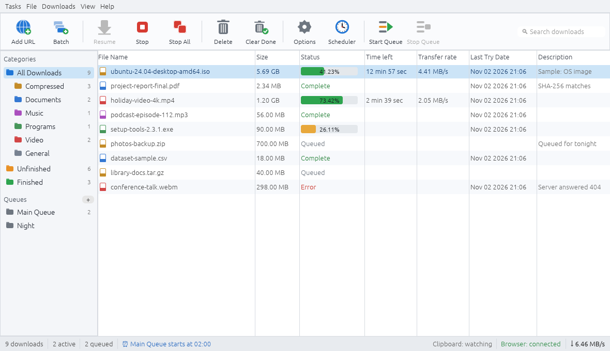

<div align="center">

# Swift Download Manager

**A fast, IDM-inspired download manager for Windows, Linux and macOS, written in Rust.**

[](https://github.com/Namitjain07/Swift-Download-Manager/releases/latest)
[](LICENSE)




<sub>The main window, shown with the app's built-in sample data (<code>--demo</code> mode).</sub>

</div>

## Why Swift Download Manager?

Most downloads use a single connection and leave your bandwidth idle. Swift Download Manager splits every file into
several parts, downloads them at the same time, and keeps going when a connection drops, so big files finish
sooner and a broken connection never means starting over.

## Features

**Fast and reliable**
- Splits each download into up to **32 connections**; a free connection takes half of the biggest remaining part
- **Pause and resume**, even after closing the app; broken connections are retried and busy servers get fewer connections
- **SHA-256 checksum** check, plus refreshing a link that has expired

**Organised**
- **Queues** with their own schedules (start and stop times, daily or once, close the app when done)
- **Categories** with your own file types and folders, search, and sorting by any column
- **Batch downloads**: a list of links, or numbered links such as `img*.jpg`; import and export link lists, or drop link files onto the window
- **Link grabber** that lists the files a web page links to

**In control**
- Overall and per-download **speed limits**, a **proxy**, saved site logins, and a referrer and login per download
- **Clipboard watching**: copy a download link and the app offers to download it
- A download-complete window when a file is finished

**Browser add-on** (Chrome, Edge, Brave, Opera and Firefox)
- Catches downloads you start in the browser and hands them to the app
- Passes your browser login (cookies) along, so downloads behind a login work
- Adds **Download with Swift Download Manager** to the right-click menu
- Spots videos and sounds that a page plays

## Download

Get the files from the [**latest release**](https://github.com/Namitjain07/Swift-Download-Manager/releases/latest).

| Platform | File | How to install |
| --- | --- | --- |
| **Windows 10/11** (64-bit) | `SwiftDownloadManager.exe` | Double-click it. No installer needed. Windows may warn about an unknown app: choose **More info**, then **Run anyway**. |
| **Windows**, with browser add-on | `SwiftDownloadManager-<version>-windows-x64.zip` | The same program together with the browser add-on and a short read-me. |
| **Ubuntu 24.04+, Debian 13+, Mint 22+** (64-bit) | `swift-download-manager_<version>_amd64.deb` | Double-click it, or run `sudo apt install ./swift-download-manager_<version>_amd64.deb`. |
| **macOS** | build it, see below | A Mac app can only be built on a Mac. See [`mac/HOW TO GET THE MAC VERSION.txt`](mac/HOW%20TO%20GET%20THE%20MAC%20VERSION.txt). On first start, right-click the app and choose **Open**, because it is not signed with a paid Apple developer account. |
| **Older Linux** (e.g. Ubuntu 22.04) | build it, see below | `bash packaging/linux/build-deb.sh` in [`source/`](source/). |

Every release also lists a `SHA256SUMS` file so you can check what you downloaded.

### Browser add-on

| Browser | File |
| --- | --- |
| Chrome, Edge, Brave, Opera | `SwiftDownloadManager-Helper-<version>-chrome.zip` |
| Firefox | `SwiftDownloadManager-Helper-<version>-firefox.xpi` |

The app has to be running for downloads to go to it; otherwise the browser downloads as usual.

- **Chrome, Edge, Brave, Opera:** unzip the file into a folder you keep, open `chrome://extensions` (Edge: `edge://extensions`),
  turn on **Developer mode**, click **Load unpacked** and choose the folder.
- **Firefox:** to try it now, open `about:debugging`, click **This Firefox**, then **Load Temporary Add-on…** and choose the `.xpi`.
  Temporary add-ons are removed when Firefox closes. To keep it, Firefox needs the file signed; see
  [`browser-extension/HOW TO INSTALL.txt`](browser-extension/HOW%20TO%20INSTALL.txt).

The same steps are in the app under **Help > Browser integration**.

## Build it yourself

Install Rust from <https://rustup.rs>, then, in the [`source/`](source/) folder:

| For | Command | Result |
| --- | --- | --- |
| Run it now | `cargo run --release` | opens the app |
| Linux installer (.deb) | `bash packaging/linux/build-deb.sh` | `dist/*.deb` |
| Windows (from Windows) | `cargo build --release` | `target/release/swift_download_manager.exe` |
| Windows (from Linux) | `bash packaging/windows/build-windows.sh` | `dist/windows/*.zip` |
| Mac (on a Mac) | `bash packaging/macos/build-mac.sh` | `dist/*.dmg` |
| Browser add-on | `python3 packaging/browser/build_extension.py` | `dist/browser/` (Chrome .zip, Firefox .xpi) |
| Run the tests | `cargo test` | the automatic tests |

On Linux the app also needs the usual desktop libraries (they are already there on desktop systems).
The full build notes are in [`source/README.md`](source/README.md).

### Retaking the screenshot

The app can draw itself with sample data and save a picture of its window, which is how the screenshot above was made:

```bash
cd source
cargo run --release -- --screenshot ../docs/images/screenshot.png
```

On a machine without a screen, put `xvfb-run -a` in front of the program.

## What is in this repository

| Path | What it is |
| --- | --- |
| [`source/`](source/) | The Rust source code and the installer scripts |
| [`source/src/engine.rs`](source/src/engine.rs) | The download engine: connections, splitting, resume, retries, speed limits |
| [`source/src/bridge.rs`](source/src/bridge.rs) | The local link listener for the browser add-on, and clipboard watching |
| [`source/src/app.rs`](source/src/app.rs), [`source/src/app/`](source/src/app/) | The window, dialogs, queues, scheduler and link grabber |
| [`browser-extension/`](browser-extension/) | The browser add-on, packaged for Chrome and Firefox |
| `linux/`, `windows/`, `mac/` | The ready-made program for each system |
| [`docs/`](docs/) | Images used by this read-me |

Settings and the download list are saved in `~/.config/swift-download-manager/` on Linux and macOS,
and in `%APPDATA%\swift-download-manager\` on Windows.

## Releases

Releases are listed on the [releases page](https://github.com/Namitjain07/Swift-Download-Manager/releases), and what changed
in each one is in [`CHANGELOG.md`](CHANGELOG.md). Pushing a tag such as `v1.2.0` publishes a release; see
[`.github/workflows/release.yml`](.github/workflows/release.yml).

## License

Released under the Apache License 2.0. See [`LICENSE`](LICENSE).
