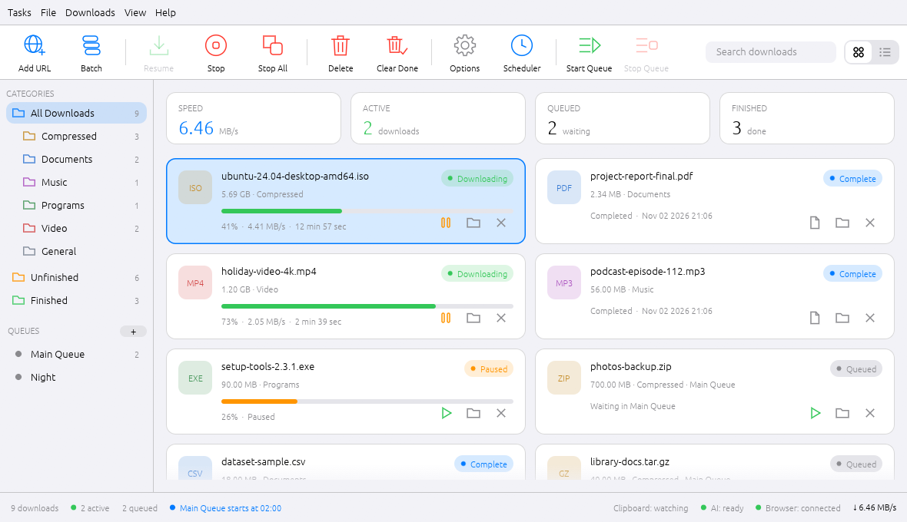

<div align="center">


# Swift Download Manager

**A fast, IDM-inspired download manager for Windows, Linux and macOS, written in Rust.**

[](https://github.com/Namitjain07/Swift-Download-Manager/releases/latest)
[](LICENSE)


<picture>
  <source media="(prefers-color-scheme: dark)" srcset="docs/images/screenshot-dark.png">
  
</picture>

<sub>The main window in the default **Drishti** design, light and dark (it follows your system), with the app's built-in sample data (<code>--demo</code> mode).</sub>

  

<sub>It adapts to the window: full layout, an icon rail at medium widths, a drawer and overflow menu when narrow. Right: the optional iOS design.</sub>

</div>

## Why Swift Download Manager?

Most downloads use a single connection and leave your bandwidth idle. Swift Download Manager splits every file into
several parts, downloads them at the same time, and keeps going when a connection drops, so big files finish
sooner and a broken connection never means starting over.

## Features

**Fast and reliable**
- Splits each download into up to **32 connections**; a free connection takes half of the biggest remaining part
- **Pause and resume**, even after closing the app; broken connections are retried and busy servers get fewer connections
- **SHA-256 checksum** check, plus refreshing a link that has expired

**A calm, native-feeling window**
- **Responsive**: downloads are cards in a grid that gains columns as the window widens (or the classic table, one click away); the sidebar becomes an icon rail and then a drawer, and the toolbar collapses to icons and an overflow menu on narrow windows
- **In a web browser and for a whole team** *(pre-release 1.6.0-beta.1)*: a page on a localhost address, and a Docker image that serves several people from one machine
- **Several networks at once** *(pre-release 1.5.0-beta.1)*: tick Wi-Fi, Ethernet, a phone's hotspot and more under **Options → Networks** and every download uses all of them together, so the speeds add up
- Two designs, switchable under **View → Appearance** (or in **Options**): **Drishti** (the default), built from the Drishti design system with a dark-first palette, 36 px rounded controls, a sidebar rail and state chips that always carry a word, and the flat **iOS** look with capsule buttons and grouped cards. Both come in light and dark and follow your system
- Smooth animations: buttons fade and press, the sidebar highlight slides, progress bars glide, and windows fade in. The window stays idle when nothing moves

**Runs in the background**
- Close the window and **keep downloading**: an icon in the system tray (Windows notification area, macOS menu bar, Linux tray) shows what is going on, pauses and resumes everything, and opens the window again
- Queues, schedules and the browser add-on keep working with no window open; optionally **start with the system**, in the background

**Organised**
- **Queues** with their own schedules (start and stop times, daily or once, close the app when done)
- **Categories** with your own file types and folders, search, and sorting by any column
- **Batch downloads**: a list of links, or numbered links such as `img*.jpg`; import and export link lists, or drop link files onto the window
- **Link grabber** that lists the files a web page links to

**In control**
- Overall and per-download **speed limits**, a **proxy**, saved site logins, and a referrer and login per download
- **Clipboard watching**: copy a download link and the app offers to download it
- A download-complete window when a file is finished

**AI assistants** (Model Context Protocol)
- Let Claude or another MCP-capable assistant list, add, pause, resume and remove downloads: see [Use it from an AI assistant](#use-it-from-an-ai-assistant-mcp)
- Works with the window open, or without it: close the window and the assistant's downloads keep going; open it again and it takes over mid-download
- On by default with a switch in the app; assistants cannot delete files or choose folders

**Browser add-on** (Chrome, Edge, Brave, Opera and Firefox)
- Catches downloads you start in the browser and hands them to the app
- Passes your browser login (cookies) along, so downloads behind a login work
- Adds **Download with Swift Download Manager** to the right-click menu
- Spots videos and sounds that a page plays

## Run it in the background

By default, closing the window while downloads are running asks whether to **keep downloading in the background**; you can remember the answer
(**Options → Background**) or use **Tasks → Keep running in the background** at any time. The program then carries on without a window, with an icon in the
system tray:

- **Click the icon** (or choose *Open Swift Download Manager*) to bring the window back; it takes the downloads over without interrupting them
- *Pause all downloads* and *Resume downloads* from the icon's menu; the tooltip shows how many downloads run and how fast
- *Quit* stops everything and exits. **Tasks → Exit** in the window always quits
- Links from the browser add-on are added and started straight away while there is no window
- **Options → Background → Start with the system** starts it at login, in the background (a launch entry on Linux and macOS, a `Run` key on Windows)

On Linux the icon needs a desktop that shows tray icons (KDE, Xfce, Cinnamon, MATE, or GNOME with the AppIndicator extension). Without one, the program still
runs in the background; start it again to open the window.

## Use it from a web browser

*Pre-release (1.6.0-beta.1).*

Open **Options → Web interface**, turn it on and press **Open**. The page lists your downloads as cards, and lets you add links, pause, resume,
remove and download finished files. It follows your system's light or dark setting and works on a phone as well.

<p align="center"></p>

- Only this computer can reach it (`127.0.0.1`, port 9615 unless you change it). The link carries a secret key, so treat it like a password; the browser
  swaps it for a cookie and the key disappears from the address bar
- It runs inside the window, or in the background when only the tray icon is left

## Run it for your organisation

*Pre-release (1.6.0-beta.1).*

`swift_download_manager --server` runs as a download server with no window. People sign in to the web page with their own accounts, add links, and the **server**
downloads them; they fetch the finished files through the same address. Each person sees only their own downloads and gets a folder of their own
(`/data/downloads/<name>`); administrators see everybody's.

<p align="center"> </p>

### With Docker

```sh
docker run -d --name sdm -p 8080:8080 -v sdm-data:/data \
  -e SDM_ADMIN_USER=admin -e SDM_ADMIN_PASSWORD='a long password' \
  ghcr.io/namitjain07/swift-download-manager:beta
```

Open <http://localhost:8080/> and sign in. (`:beta` follows the newest pre-release; `:1.6.0-beta.1` pins one. Stable versions also get `:latest`.)
Everything lives in the `/data` volume: settings, accounts, the download list and the files. The image is for 64-bit Intel/AMD machines for now.

Add more people:

```sh
docker exec -i -e SDM_PASSWORD='their password' sdm swift-download-manager --add-user anna          # a normal user
docker exec -i -e SDM_PASSWORD='their password' sdm swift-download-manager --add-user ben --admin   # an administrator
docker exec sdm swift-download-manager --list-users
docker exec sdm swift-download-manager --remove-user anna      # their downloads stay on disk
```

With docker compose:

```yaml
services:
  sdm:
    image: ghcr.io/namitjain07/swift-download-manager:beta
    restart: unless-stopped
    ports: ["8080:8080"]
    volumes: ["sdm-data:/data"]
    environment:
      SDM_ADMIN_USER: admin
      SDM_ADMIN_PASSWORD: change-me-to-a-long-password
volumes:
  sdm-data:
```

### Without Docker

```sh
SDM_PASSWORD='a long password' swift_download_manager --server --add-user admin --admin --data /srv/sdm
swift_download_manager --server --data /srv/sdm --downloads /srv/sdm/files --bind 0.0.0.0 --port 8080
```

Options (each also has an environment variable): `--bind` (`SDM_BIND`, default `0.0.0.0`), `--port` (`SDM_PORT`, `8080`), `--data` (`SDM_DATA`), `--downloads`
(`SDM_DOWNLOADS`), `--secure-cookie` (`SDM_SECURE_COOKIE`), `--allow-private` (`SDM_ALLOW_PRIVATE`).

### Before you put it on a network

- **Use HTTPS.** The server speaks plain HTTP; put a reverse proxy in front of it (Caddy, nginx, Traefik) that adds TLS, and add `--secure-cookie`. For example, with Caddy:
  `sdm.example.org { reverse_proxy localhost:8080 }`
- **Private addresses are refused.** A download server can be tricked into fetching from the network behind it, so links to private or local addresses
  (`10.x`, `192.168.x`, `localhost`, the cloud metadata address, ...) are refused, also after redirects. `--allow-private` switches that off for a trusted team
- Passwords are stored as salted hashes; five wrong passwords from one address block it for five minutes; sessions last a week and end when you sign out
- Accounts are managed from the command line; there is no page for it yet. It is a pre-release: please report what you find

## Download over several networks at once

*Pre-release (1.5.0-beta.1): get it from the releases page, where it is marked as a pre-release.*

Open **Options → Networks**, turn on **Download over several networks at once** and tick the network cards to use: Wi-Fi, Ethernet, a phone's
USB or hotspot connection. A download is then spread over all of them.

<p align="center"></p>

- Each connection of a download is tied to one network card. Every card always gets a connection and the faster cards get more, so the speeds add
  up and a slow card never holds the others back
- A card that stops working (cable pulled, phone out of range) is left alone for 30 seconds while the others carry on
- The progress window shows what each network is carrying
- When networks are chosen, nothing falls back to the normal connection: if none of them works, the download says so
- Linux ties the traffic to the card with `SO_BINDTODEVICE` (kernel 5.7 or newer; older kernels use the card's address), macOS with `IP_BOUND_IF`, and
  Windows with the card's address. The logic is tested on Linux with separate local addresses standing in for networks; it has not yet been tried with
  real phones and cables on Windows or macOS, so please report what you see

## Use it from an AI assistant (MCP)

Swift Download Manager speaks the [Model Context Protocol](https://modelcontextprotocol.io), so an assistant such as Claude
can look at your downloads and manage them for you ("download this video", "pause everything", "what is still running?").


**Connect it.** The assistant starts the program itself with `--mcp`. The app shows these commands with the right path
filled in under **Help → AI assistants…**.

| Client | How |
| --- | --- |
| Claude Code | `claude mcp add swift-download-manager -- /path/to/swift_download_manager --mcp` |
| Claude Desktop and most other apps | add the block below to their MCP settings |

```json
{ "mcpServers": { "swift-download-manager": { "command": "/path/to/swift_download_manager", "args": ["--mcp"] } } }
```

On Windows use the path of `SwiftDownloadManager.exe`. (`--mcp` talks over standard input and output, which relies on the
assistant starting the program with pipes, as MCP clients do.)

**What it can do.** Ten tools; assistants that support it ask you before each action unless you tell them not to.

| Tool | What it does |
| --- | --- |
| `list_downloads`, `get_download` | See downloads, their progress, speed and errors (read-only) |
| `get_status`, `list_queues` | Overall state; queues and their schedules (read-only) |
| `add_download` | Start a download from an `http(s)` link; saved in the folder of its category |
| `pause_download`, `resume_download` | Pause or resume one download |
| `start_queue`, `stop_queue` | Run or stop a queue |
| `remove_download` | Take a download off the list (marked as destructive so clients ask first) |

**With or without the window.** If the window is open, the assistant works in it and you see changes live. If it is
closed, the assistant runs the downloads itself in the background. Opening the window while a download is running pauses it,
hands everything over and carries on in the window, byte for byte. (If the window is minimized and your system stops
redrawing it, a request can time out after 10 seconds with a message saying so; restore the window and ask again.)

**Safety.**
- It is on by default; switch it off under **Options** or **Help → AI assistants…** and every request is refused.
- An assistant can never delete files from your disk (not even partly downloaded ones) and cannot choose where a file is
  saved: the folder always comes from the file's category. Only `http` and `https` links are accepted.
- The window listens only on your own computer, on a random port, and only answers requests that carry a secret token stored in
  your settings folder (`mcp-token`, readable only by you). Requests that come from a web page are refused. This is separate
  from the browser add-on's listener.
- Passwords and cookies are never shown to the assistant.

## Download

Get the files from the [**latest release**](https://github.com/Namitjain07/Swift-Download-Manager/releases/latest).

| Platform | File | How to install |
| --- | --- | --- |
| **Windows 10/11** (64-bit) | `SwiftDownloadManager.exe` | Double-click it. No installer needed. It is signed with the project's own certificate, so Windows may say the publisher is unknown: choose **More info**, then **Run anyway** (see [Windows warnings](#windows-warnings-and-antivirus)). |
| **Windows**, with browser add-on | `SwiftDownloadManager-<version>-windows-x64.zip` | The same program together with the browser add-on, the certificate and a short read-me. |
| **Ubuntu 22.04+, Debian 12+, Mint 21+** (64-bit) | `swift-download-manager_<version>_amd64.deb` | Double-click it, or run `sudo apt install ./swift-download-manager_<version>_amd64.deb`. |
| **macOS** | build it, see below | A Mac app can only be built on a Mac. See [`mac/HOW TO GET THE MAC VERSION.txt`](mac/HOW%20TO%20GET%20THE%20MAC%20VERSION.txt). On first start, right-click the app and choose **Open**, because it is not signed with a paid Apple developer account. |
| **Other Linux** | build it, see below | `bash packaging/linux/build-deb.sh` in [`source/`](source/). |

All files are built and, for Windows, signed by GitHub from the release's source code (see [`release.yml`](.github/workflows/release.yml)).

Every release also lists a `SHA256SUMS` file so you can check what you downloaded.

### Browser add-on

| Browser | File |
| --- | --- |
| Chrome, Edge, Brave, Opera | `SwiftDownloadManager-Helper-<version>-chrome.zip` |
| Firefox | `SwiftDownloadManager-Helper-<version>-firefox.xpi` |

The app has to be running for downloads to go to it; otherwise the browser downloads as usual.

- **Chrome, Edge, Brave, Opera:** unzip the file into a folder you keep, open `chrome://extensions` (Edge: `edge://extensions`),
  turn on **Developer mode**, click **Load unpacked** and choose the folder.
- **Firefox:** to try it now, open `about:debugging`, click **This Firefox**, then **Load Temporary Add-on…** and choose the `.xpi`.
  Temporary add-ons are removed when Firefox closes. To keep it, Firefox needs the file signed; see
  [`browser-extension/HOW TO INSTALL.txt`](browser-extension/HOW%20TO%20INSTALL.txt).

The same steps are in the app under **Help > Browser integration**.

### Windows warnings and antivirus

**"Windows protected your PC" / unknown publisher.** The exe is signed with this project's own code-signing certificate,
not one bought from a certificate authority, so Windows cannot tell who you are dealing with. That is expected. To check you have
the genuine file, compare its SHA-256 with `SHA256SUMS` on the release page and look at the signature:

```powershell
Get-AuthenticodeSignature .\SwiftDownloadManager.exe | Format-List Status, SignerCertificate
```

The signer must be `CN=Swift Download Manager, O=Namitjain07` with SHA-256 fingerprint
`22:B1:AE:1A:D3:BC:C4:0D:F5:3E:81:FD:D1:6A:E1:8E:83:22:2A:FC:51:B9:E6:A1:6A:F5:66:34:AE:F3:86:7A`
(the public certificate is `swift-download-manager-codesign.cer` in the zip and in the repository).

**`Trojan:Win32/Bearfoos.A!ml` or similar.** Version 1.2.0 was reported as this by Windows Defender. It is a *machine-learning guess* about
programs it has not seen before, not a match with known malware, and it was a false positive: that build was an unsigned program with no
icon, version information or manifest. From 1.3.0 the program is built with Microsoft's own toolchain, carries that information and is
signed. If Defender still objects, open **Protection history**, restore the file, and please
[send it to Microsoft](https://www.microsoft.com/en-us/wdsi/filesubmission) as a false positive (choose "Software developer").
The source is here to read; see also [`SECURITY.md`](SECURITY.md).

## Build it yourself

Install Rust from <https://rustup.rs>, then, in the [`source/`](source/) folder:

| For | Command | Result |
| --- | --- | --- |
| Run it now | `cargo run --release` | opens the app |
| Linux installer (.deb) | `bash packaging/linux/build-deb.sh` | `dist/*.deb` |
| Windows (from Windows) | `cargo build --release` | `target/release/swift_download_manager.exe` (with icon and version information) |
| Windows (from Linux, unsigned) | `bash packaging/windows/build-windows.sh` | `dist/windows/*.zip` (for testing; releases come from GitHub's Windows build) |
| Mac (on a Mac) | `bash packaging/macos/build-mac.sh` | `dist/*.dmg` |
| Browser add-on | `python3 packaging/browser/build_extension.py` | `dist/browser/` (Chrome .zip, Firefox .xpi) |
| Run the tests | `cargo test` | the automatic tests |

On Linux the app also needs the usual desktop libraries (they are already there on desktop systems).
The full build notes are in [`source/README.md`](source/README.md).

### Retaking the screenshots

The app can draw itself with sample data and save a picture of its window, which is how the screenshots above were made:

```bash
cd source
cargo run --release -- --screenshot ../docs/images/screenshot.png --theme light
cargo run --release -- --screenshot ../docs/images/screenshot-dark.png --theme dark
cargo run --release -- --screenshot ../docs/images/screenshot-ios.png --theme light --style ios
# the other design: --style ios   (drishti is the default)
# a window other than the main one: --show add|batch|options|networks|scheduler|queues|properties|progress|delete|about|browser|grabber
cargo run --release -- --screenshot /tmp/scheduler.png --theme dark --show scheduler
```

On a machine without a screen, put `xvfb-run -a` in front of the program.

## What is in this repository

| Path | What it is |
| --- | --- |
| [`source/`](source/) | The Rust source code and the installer scripts |
| [`source/src/engine.rs`](source/src/engine.rs) | The download engine: connections, splitting, resume, retries, speed limits |
| [`source/src/bridge.rs`](source/src/bridge.rs) | The local link listener for the browser add-on, and clipboard watching |
| [`source/src/background.rs`](source/src/background.rs), [`source/src/background/`](source/src/background/) | Running without a window: the tray icon and the loop behind it |
| [`source/src/mcp/`](source/src/mcp/) | The MCP server for AI assistants: protocol, the private control door, the lock and hand-over |
| [`source/src/app.rs`](source/src/app.rs), [`source/src/app/`](source/src/app/) | The window, dialogs, queues, scheduler and link grabber |
| [`source/src/theme/`](source/src/theme/), [`source/src/widgets/`](source/src/widgets/) | The two designs (Drishti and iOS) in light and dark, and the widget kit (buttons, switch, wheel picker, progress bars) |
| [`browser-extension/`](browser-extension/) | The browser add-on, packaged for Chrome and Firefox |
| `mac/` | How to get the Mac version |
| [`docs/`](docs/) | Images used by this read-me |

Settings and the download list are saved in `~/.config/swift-download-manager/` on Linux and macOS,
and in `%APPDATA%\swift-download-manager\` on Windows.

## Releases

Releases are listed on the [releases page](https://github.com/Namitjain07/Swift-Download-Manager/releases), and what changed
in each one is in [`CHANGELOG.md`](CHANGELOG.md). Pushing a tag such as `v1.3.0` builds, signs and publishes a release (a version with a dash, such as `1.5.0-beta.1`, is published as a pre-release); see
[`.github/workflows/release.yml`](.github/workflows/release.yml).

## Contributing

Bug reports, ideas and pull requests are welcome. Please read the [contributing guide](CONTRIBUTING.md) first, and
note that everyone taking part is expected to follow the [code of conduct](CODE_OF_CONDUCT.md). To report a problem
or ask for a feature, [open an issue](https://github.com/Namitjain07/Swift-Download-Manager/issues/new/choose).

Pull requests are built and tested automatically on Linux, Windows and macOS (see
[`.github/workflows/ci.yml`](.github/workflows/ci.yml)).

## Security

Please do not report security problems in a public issue. See the [security policy](SECURITY.md) for how to report
them privately.

## License

Released under the Apache License 2.0. See [`LICENSE`](LICENSE).
